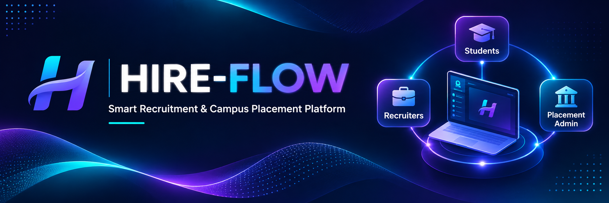
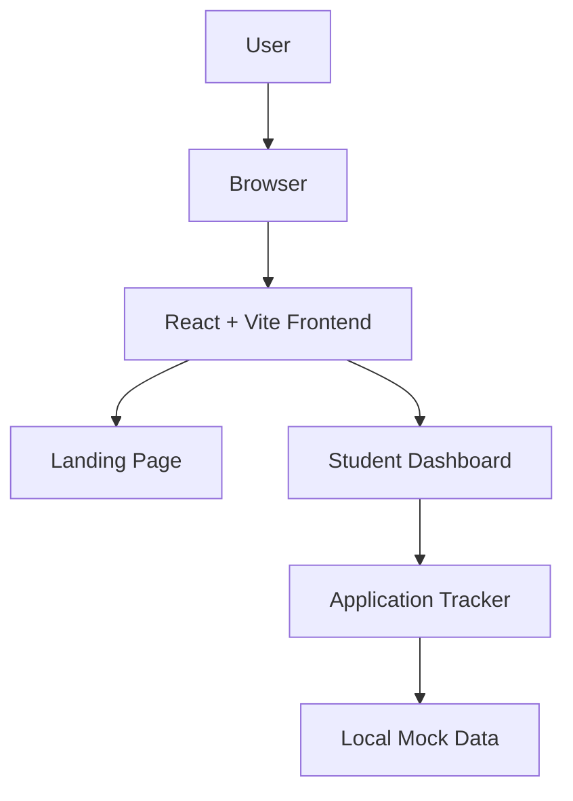
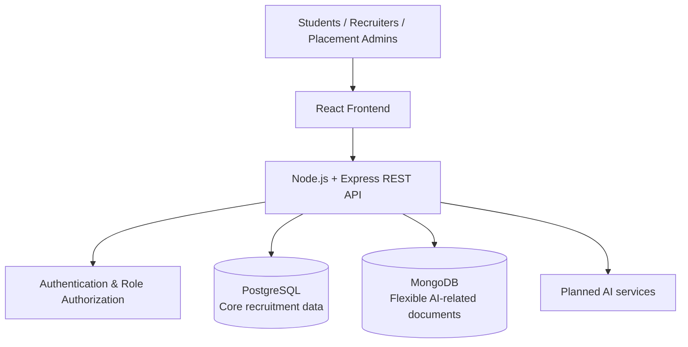

<p align="center">
  
</p>

<h1 align="center">HIRE-FLOW</h1>

<p align="center">
  <strong>Smart Recruitment &amp; Campus Placement Platform</strong><br>
  A unified platform concept connecting students, recruiters, and placement administrators.
</p>

<p align="center">
  
  
  
  
  
  
  
</p>

<p align="center">
  <a href="#project-overview">Overview</a> ·
  <a href="#current-implementation">Implementation</a> ·
  <a href="#architecture">Architecture</a> ·
  <a href="#getting-started">Getting Started</a> ·
  <a href="#project-roadmap">Roadmap</a>
</p>

---

## Project Overview

HireFlow is a recruitment and campus placement management platform being developed to bring student career activity, recruiter workflows, and placement-office coordination into one application.

The intended product has three role-based areas:

- **Students** — maintain career profiles, explore opportunities, submit applications, and track recruitment progress.
- **Recruiters** — publish opportunities, review applicants, manage shortlists, and coordinate interviews.
- **Placement administrators** — coordinate placement activities, manage participants, and monitor placement progress.

The project is being developed incrementally. The current repository contains an early React frontend prototype; backend services, persistent databases, authentication, and AI integrations are planned work and are not represented as completed features.

## Current Implementation

### Implemented

- React application bootstrapped with Vite.
- Landing page and reusable frontend components.
- Student dashboard prototype.
- Application tracker using local mock data.
- Application search by company or role.
- Combined application-status filtering and search.
- Application details modal with keyboard and focus interactions.
- Dashboard metrics calculated from the current mock application dataset.
- ESLint validation and Vite production build successfully run during the Day 4 milestone.

### Not implemented yet

- Backend API and server-side business logic.
- PostgreSQL or MongoDB connection and persistence.
- Authentication, sessions, and server-enforced role-based authorization.
- Completed recruiter and placement-administrator interfaces.
- Live job listings or real application submissions.
- AI-powered resume analysis or interview assistance.
- Production deployment.

> **Prototype note:** The current application tracker and dashboard use local mock data. Displayed records and metrics are demonstration data, not live recruitment information.

## Product Areas

| Area | Intended capabilities | Current status |
|---|---|---|
| Student | Profile, opportunities, applications, interview tracking | Initial dashboard and mock-data application tracker implemented |
| Recruiter | Job publishing, applicant review, shortlisting, interview scheduling | Planned |
| Placement Admin | Student/recruiter coordination, placement drives, analytics | Planned |

## Technology Stack

| Layer | Technology | Status |
|---|---|---|
| Frontend | React, JavaScript, Vite | Implemented |
| Frontend styling | CSS currently used; Tailwind CSS in the planned stack | Tailwind integration not yet completed |
| Backend | Node.js, Express.js | Planned |
| Primary database | PostgreSQL | Planned |
| Flexible document storage | MongoDB | Planned |
| Version control | Git, GitHub | In use |

## Architecture

### Current prototype

The current working flow is frontend-only. The UI reads local mock data; there is no live API or database connection.



### Planned target architecture

The following is the intended architecture, not the current deployed implementation.



PostgreSQL is intended for structured records and relationships such as users, jobs, applications, and interviews. MongoDB is planned for flexible document-oriented data. These database responsibilities will be finalized during backend and database implementation.

## Repository Structure

```text
HIRE-FLOW/
├── client/                 # React + Vite frontend
├── server/                 # Planned Express backend workspace
├── docs/
│   ├── architecture/
│   ├── daily-learning/
│   │   ├── DAY-01.md
│   │   ├── DAY-02.md
│   │   ├── DAY-03.md
│   │   └── DAY-04.md
│   ├── technical-reference/
│   └── troubleshooting/
├── .gitignore
└── README.md
```

The structure may evolve as backend, database, and additional frontend modules are implemented.

## Getting Started

### Prerequisites

- Node.js and npm installed.
- Git installed.
- A local clone of this repository.

### Clone the repository

```bash
git clone https://github.com/mudassarnazer/hire-flow.git
cd hire-flow
```

### Install frontend dependencies

```bash
cd client
npm install
```

### Start the development server

```bash
npm run dev
```

Vite will print the local development URL in the terminal (typically `http://localhost:5173/`).

### Run validation

From the repository root:

```bash
npm --prefix client run lint
npm --prefix client run build
```

The backend is not currently available as a runnable service; the `server/` workspace is reserved for planned backend development.

## Development Progress

| Milestone | Focus | Status |
|---|---|---|
| Day 1 | Requirements, project structure, environment setup | Completed |
| Day 2 | React + Vite setup and landing page | Completed |
| Day 3 | Reusable components and student dashboard | Completed |
| Day 4 | React state, search, filtering, modal, dynamic metrics | Completed |
| Day 5 | Tailwind CSS and UI refinement | Not started |
| Later milestones | Backend, databases, APIs, authentication, AI, testing and deployment | Planned |

Daily learning logs are available in [`docs/daily-learning/`](docs/daily-learning/).

## Validation

At the Day 4 milestone, the following checks were run successfully:

- `npm --prefix client run lint`
- `npm --prefix client run build`
- `git diff --cached --check`

The developer also reported completing browser interaction checks. Those manual checks are recorded as developer-reported rather than independently audited test results.

## Contributing and Development Notes

This is an actively developed learning and portfolio project. Features and architecture may change as implementation progresses. Please distinguish working prototype functionality from planned capabilities when reviewing the repository.

## Developer

**MUDASSAR NAZER**

Repository: [github.com/mudassarnazer/hire-flow](https://github.com/mudassarnazer/hire-flow)

---

<p align="center">
  <sub>HIRE-FLOW · Recruitment and Campus Placement Management Platform</sub>
</p>
